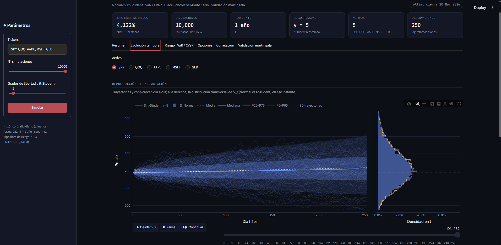

#Multi-Asset Geometric Brownian Motion (GBM) & Tail Risk Simulator

#Overview & Motivation
The goal of this project is to bridge quantitative finance theory and practical implementation by modeling asset price dynamics through Geometric Brownian Motion (GBM). Specifically, it contrasts classical theoretical assumptions against real market behavior by comparing two return distributions:
* Normal Distribution: The standard Gaussian assumption behind classical GBM.
* Rescaled Student's T-Distribution: A heavy-tailed distribution that better captures the extreme market moves (fat tails) observed in real financial time series.

#Quantitative & Mathematical Core
Beyond generating price paths, the engine extracts key risk and validation metrics:
* Tail Risk & Drawdown Exposure Var and CVar: Evaluates Value at Risk and Conditional Value at Risk (Expected Shortfall) at the 95% confidence level to measure realistic downside risk rather than relying solely on expected returns.
* Itô's Lemma & Volatility Drag (Mean vs. Median): Demonstrates how the expected value and the median path diverge over time due to the drift correction term derived from Itô's Lemma.
* Portfolio Correlation via Cholesky Decomposition: Models cross-asset dependencies within a multi-asset portfolio by decomposing the empirical correlation matrix into a lower-triangular matrix to generate correlated stochastic shocks.
* Model Verification & Pricing Convergence: Validates the numerical accuracy of the simulation using the risk-neutral martingale property and benchmarks Monte Carlo European Call pricing against the analytical Black-Scholes closed-form solution to verify convergence.

#Engineering Challenges & Architecture
* Vectorized Computation (`NumPy` & `SciPy`): Implementing this engine was a significant engineering challenge focused on execution efficiency—moving away from standard loops to full 3D tensor vectorization in `NumPy` and statistical modeling in `SciPy`.
* Visualization Layer: The core mathematical and numerical engine was coded from scratch, while AI-assisted tooling was used to build the interactive `Streamlit` and `Plotly` frontend so the simulation results could be rendered cleanly and explored intuitively (despite the inherent rendering overhead of multi-path browser animations).

#Current Limitations & Next Steps
While I am satisfied with how the theoretical framework translates into working code, this model remains a baseline approximation because it relies on static historical volatility estimated from past data. 

#Upcoming improvements:
1. Implement numerical Implied Volatility solvers from live option chains.
2. Model the full Volatility Surface across strikes and maturities to capture skew and term structure dynamics.
